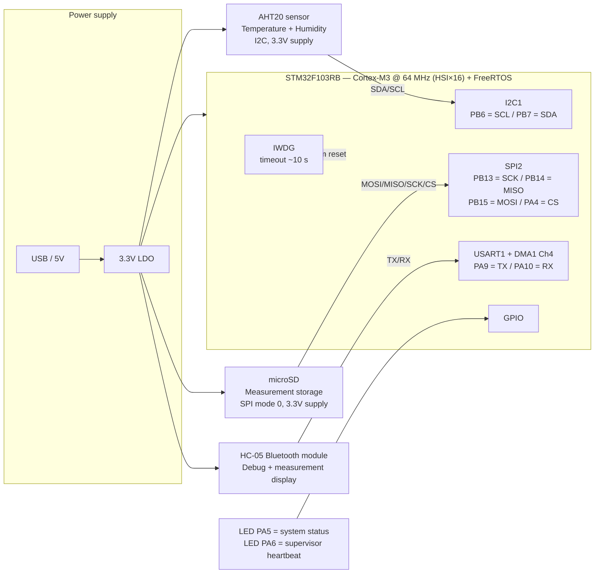
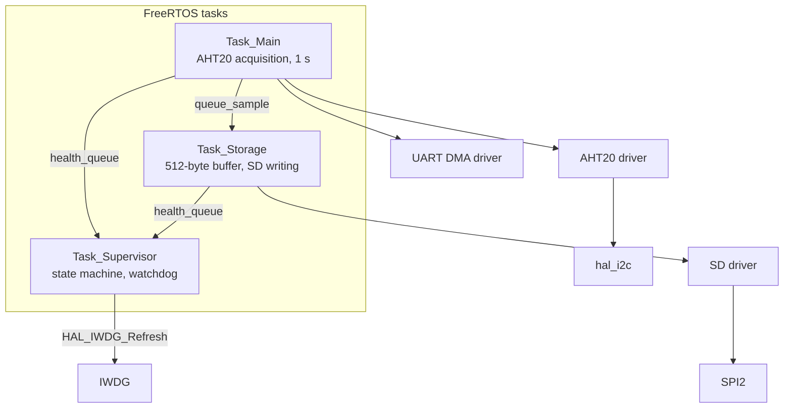
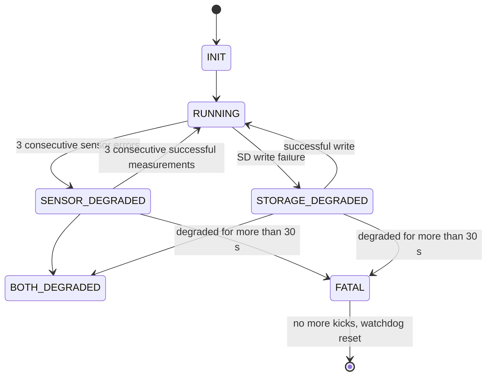
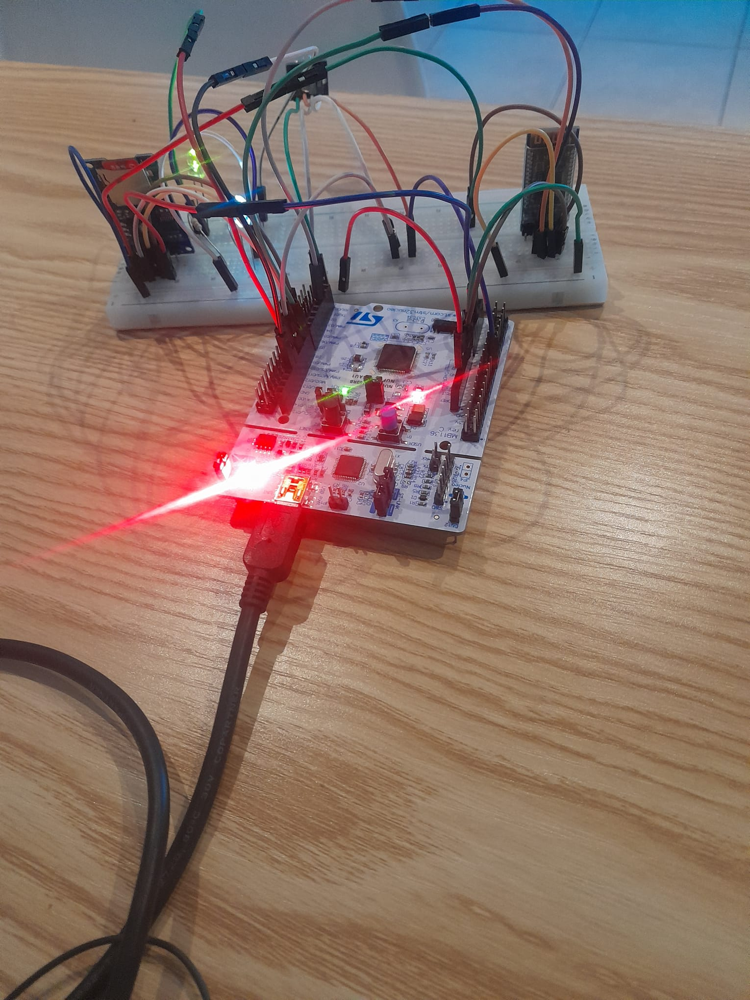

# SASE — Environmental Acquisition and Storage System

[🇫🇷 Version française](README.FR.md)

[](https://github.com/Souber-ismael/Firmware-temps-r-el-STM32-FreeRTOS-Data-Logger-/actions)

A temperature and humidity data logger based on the **STM32F103RB** and **FreeRTOS**.  
It measures, displays, and stores environmental data on a **microSD card**, with software supervision and a hardware watchdog that restarts the system in case of failure.

The project follows an industry-oriented approach:

- Drivers written without third-party libraries
- Explicit handling of every error case
- Fault-injection testing
- CI with firmware build and unit tests

## Features

- Temperature and humidity acquisition every second using the AHT20 sensor
- CRC verification of sensor measurements
- Real-time display over UART / Bluetooth (HC-05)
- Raw block storage on microSD, without a file system
- Persistent write position across resets
- FreeRTOS-based multitasking architecture
- Hardware watchdog supervision using IWDG
- Fault detection and graceful recovery
- Unit tests with Unity and Ceedling
- CI using GitHub Actions

## Hardware

| Function | Component | Interface / Pins |
|---|---|---|
| MCU | STM32F103RB (Nucleo), HSI ×16 = 64 MHz | — |
| Temperature/humidity sensor | AHT20 | I2C1: PB6 (SCL) / PB7 (SDA) |
| Storage | microSD module | SPI2: PB13 (SCK) / PB14 (MISO) / PB15 (MOSI), CS on PA4 |
| Debug and measurement display | HC-05 Bluetooth module | USART1: PA9 / PA10, TX via DMA1 Channel 4 |
| System status LED | LED | PA5 |
| Supervisor heartbeat LED | LED | PA6 |
| Watchdog | Hardware IWDG, timeout ≈ 10 s | Fed only by `Task_Supervisor` |

## Hardware Architecture



## Software Architecture

The software follows a layered architecture:

```text
FreeRTOS tasks
      ↓
Drivers: AHT20, SD, UART
      ↓
STM32 HAL
```

A task never communicates directly with the STM32 HAL.



### Tasks

| Task | Role | Period |
|---|---|---|
| `Task_Main` | Reads the AHT20, displays the result, sends the sample to `Task_Storage`, and counts consecutive errors | 1 s |
| `Task_Storage` | Accumulates valid samples in RAM, writes an SD block when full, and persists the write pointer | Event-driven |
| `Task_Supervisor` | Receives health reports, manages the state machine, and decides whether to kick the watchdog | ≤ 1 s |

### Design principles

- **Decoupling through queues**: `Task_Main` sends data without blocking (`timeout = 0`), so a slow SD card does not affect acquisition.
- **UART errors are not reported to the Supervisor**: they do not impact the measurement and storage mission.
- **Single health queue**: `health_queue` contains a source field (`sensor` or `storage`) and a raw error code.

## Supervision



- Two independent timers are used: one for the sensor and one for storage.
- Each timer allows 30 seconds before entering the `FATAL` state.
- The Supervisor waits on the health queue with a timeout capped at 1 second, ensuring that the watchdog is always serviced.
- The system returns to `RUNNING` only after several consecutive successful operations.

## Watchdog

The Independent Watchdog (IWDG) is used as a final fail-safe mechanism.

- Timeout: approximately 10 seconds.
- The actual duration is approximate because the LSI clock varies between 30 and 60 kHz depending on the chip.
- The watchdog is started by the Supervisor after the first loop of each task, avoiding a reset during SD initialization.
- It is kicked from a single location.
- The watchdog is refreshed only if:
  - The system is not in the `FATAL` state.
  - The heartbeat counters of `Task_Main` and `Task_Storage` are progressing.
- In `FATAL`, the system deliberately stops feeding the watchdog and restarts.
- At startup, the reset cause is read using `RCC_FLAG_IWDGRST` and logged.

## microSD Storage

Data is stored using raw 512-byte blocks, without a file system.  
The data can only be read back by the firmware itself.

| Block | Content |
|---|---|
| 999 | Metadata: magic number, next block to write, write counter |
| 1000 to 50999 | Log area used as a circular buffer |

### Sample format

```c
typedef struct {
    uint8_t temp_int;
    uint8_t temp_frac;
    uint8_t hum_int;
    uint8_t hum_frac;
    SensorStatus st;   /* 4 bytes (enum) */
} syste;
```

- Each sample is 8 bytes.
- Each 512-byte block contains 64 samples.
- At 1 Hz, one block is written every 64 seconds.
- The reserved area contains 50,000 blocks.
- Total capacity: approximately 3.2 million samples.
- At one measurement per second, this represents about **37 days** of logging before wrapping around.

Using `uint8_t` instead of a 4-byte enum for `SensorStatus` would reduce the sample size to 5 bytes, allowing 102 samples per block.

The write pointer is read back at startup and validated using the magic number.  
It is then updated after each successfully written block.

## SD Driver

The SD card is accessed in SPI mode.

### Initialization sequence

```text
74 clock cycles with CS high
→ CMD0
→ CMD8
→ CMD55 / ACMD41
→ CMD58
→ Low-speed initialization
→ Switch to high-speed SPI
```

### Read and write

- `CMD17` is used for single-block reads.
- `CMD24` is used for single-block writes.
- CS remains low during the entire transaction, including the data phase.
- The write sequence uses:
  - `0xFE` start token
  - 512 data bytes
  - Dummy CRC
  - Data response token verification
  - Busy wait with timeout
- Addressing depends on the card type:
  - SDHC: block number
  - SDSC: byte address

## Error Handling

| Source | Detection | Reaction |
|---|---|---|
| I2C | NACK, TIMEOUT, BUSY, BUS ERROR translated into distinct codes | Consecutive error counter, report to the Supervisor |
| Sensor | Invalid CRC, measurement not ready | Sample ignored, not stored |
| SD | Command failure, data response failure, busy timeout | Report to the Supervisor |
| UART | `HAL_BUSY`, timeout | Local handling, no impact on system status |
| Blocked task | Frozen heartbeat | No more watchdog kicks, watchdog reset |

## Testing

### Test strategy

| Level | Tools | Scope |
|---|---|---|
| Unit tests | Unity + Ceedling, run on host with GCC | Hardware-independent logic |
| Integration tests | On target, using fault injection | Full-system behavior under failure conditions |
| CI | GitHub Actions | Firmware build and unit tests on every push |

### Fault-injection tests

| # | Scenario | Expected result | Result |
|---|---|---|---|
| 1 | Sensor disconnected for 5 s then reconnected | `SENSOR_DEGRADED`, then return to `RUNNING`, without reset | 3 × Sensor_OK |
| 2 | Sensor disconnected for more than 30 s | `FATAL`, watchdog reset, resumption at the correct block | Status_fatal |
| 3 | SD card removed | `STORAGE_DEGRADED`, then `FATAL` after 30 s | Same as above |
| 4 | Infinite loop in `Task_Main` | Watchdog reset | Validated |
| 5 | Write then read back of an SD block | Identical content | Validated |
| 6 | Power cut and restart | Resumption at the next block | Validated |

## Run Unit Tests Locally

```bash
ceedling test:all
```

The exact firmware build commands are defined in:

```text
.github/workflows/
```

## Tools

- GCC
  - `arm-none-eabi-gcc` for the target
  - Host GCC for unit tests
- Unity
- Ceedling
- GitHub Actions
- FreeRTOS
- STM32 HAL

## Issues Encountered and Lessons Learned

### MISO configured as `GPIO_MODE_AF_PP`

On STM32F1, configuring MISO as `GPIO_MODE_AF_PP` caused the line to be driven as an output.  
As a result, SD reads only returned `0xFF`.

**Fix:** configure MISO as an input with pull-up.

### CS raised between command and data phase

Raising CS between `CMD17` / `CMD24` and the data phase caused the SD card to abort the transaction.

**Fix:** let the caller manage CS for the entire transaction.

### Spurious byte before write token

An uninitialized variable caused a spurious byte to be sent before the write token.  
This made the R1 response unreadable and shifted the data stream.

### UART DMA transmission

`USART1_IRQHandler` is required in addition to the DMA channel handler.  
Without it, the transmission-complete callback is never called and the HAL remains in `BUSY`.

### FreeRTOS task creation failure

Task creation failed because the FreeRTOS heap was too small.

**Fix:** increase `configTOTAL_HEAP_SIZE`.

### Task suspended after initialization failure

Using `vTaskSuspend()` after an initialization failure hid the diagnostic and made debugging harder.

## Roadmap

- Automatic SD re-initialization and SPI bus recovery
- Automatic sensor re-initialization and I2C bus recovery
- History readback through the Bluetooth link
- Remote commands through Bluetooth

## Project Preview



## Build and Flash

To be completed:

- Build tool: CubeIDE, CMake, etc.
- STM32F1 firmware package version
- Flashing procedure

## License

To be defined.
