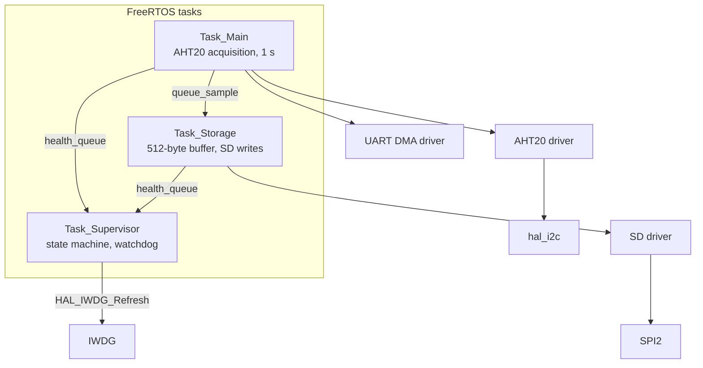
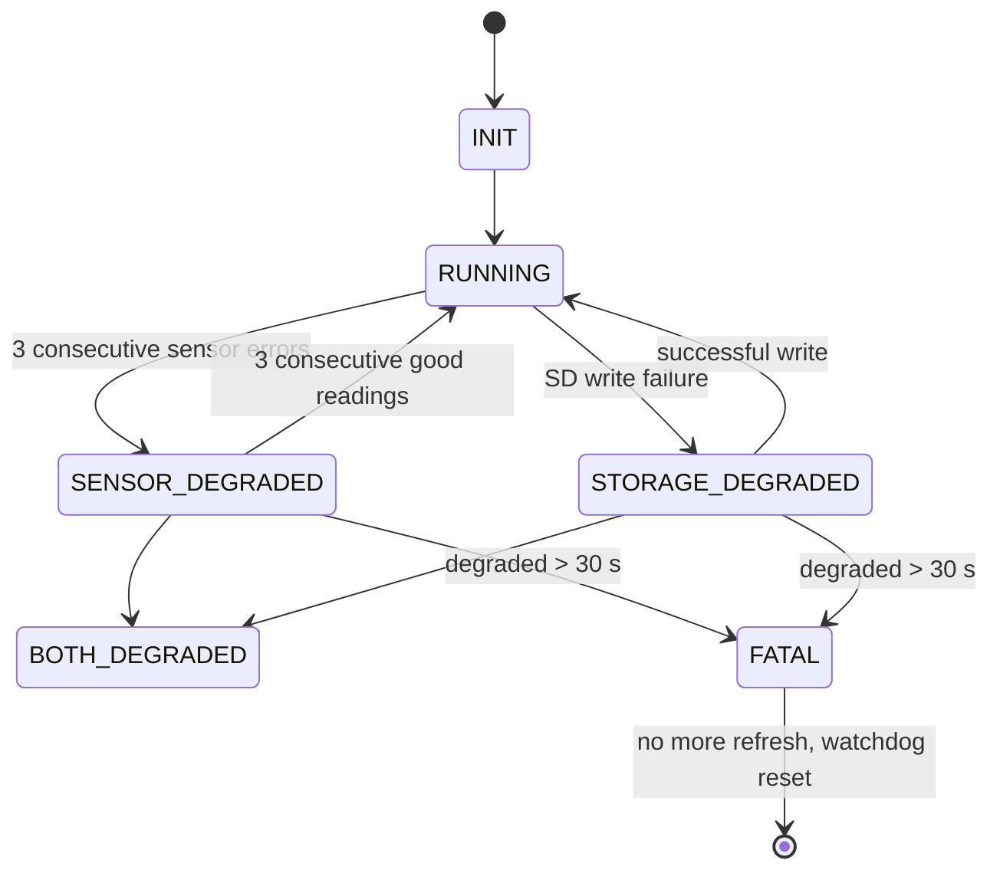

# SASE — Environmental Data Logger

[🇫🇷 Version française](README.fr.md)


FreeRTOS-based temperature and humidity logger for the STM32F103RB. It measures, reports and stores data on a microSD card, with a software supervisor and a hardware watchdog that recover the system from faults.

All drivers (I2C, SPI/SD, UART-DMA) are written from scratch, every error case is handled explicitly, and behaviour is verified with unit tests, integration tests and a CI pipeline.

## Hardware

| Function | Component | Interface / Pins |
|---|---|---|
| MCU | STM32F103RB (Nucleo), HSI ×16 = 64 MHz | — |
| Temperature / humidity sensor | AHT20 | I2C1: PB6 (SCL) / PB7 (SDA) |
| Storage | microSD module | SPI2: PB13 (SCK) / PB14 (MISO) / PB15 (MOSI), CS on PA4 |
| Debug and measurement output | Bluetooth HC-05 module | USART1: PA9 / PA10, TX over DMA1 Channel 4 |
| System status LED | LED | PA5 |
| Supervisor heartbeat LED | LED | PA6 |
| Watchdog | Hardware IWDG, timeout ≈ 10 s | Refreshed only by `Task_Supervisor` |

## Features

- One measurement per second from the AHT20, with CRC validation.
- Each measurement is sent over UART.
- Only valid measurements are stored on the microSD card, in 512-byte blocks.
- After a reset, writing resumes at the next block (write position persisted on the card).
- If a fault lasts too long, the system stops feeding the watchdog and reboots cleanly.

## Software architecture



Layered design: tasks, drivers (AHT20, SD, UART), then the STM32 HAL. A task never calls the HAL directly.

### Tasks

| Task | Role | Period |
|---|---|---|
| `Task_Main` | Reads the AHT20, sends the sample to `Task_Storage`, counts consecutive errors | 1 s |
| `Task_Storage` | Accumulates valid samples in RAM, writes an SD block when full, persists the write pointer | Event-driven |
| `Task_Supervisor` | Receives health reports, runs the state machine, decides whether to refresh the watchdog | ≤ 1 s |

Design choices:

- **Queue decoupling**: `Task_Main` sends with a zero timeout, so a slow SD card never disturbs acquisition.
- **UART errors stay local**: they do not affect the measure-and-store mission, so they are not reported to the supervisor.
- **Single health queue** (`health_queue`) carrying a source field (sensor or storage) and a raw error code.

### Supervision



- Two independent 30 s timers (sensor and storage) before `FATAL`.
- The supervisor waits on the queue with a computed timeout, capped at 1 s so the loop (and the watchdog refresh) always runs.
- Recovery to `RUNNING` requires several consecutive successes, never just one.

### Watchdog (IWDG)

- Timeout ≈ 10 s. The LSI clock varies from 30 to 60 kHz between chips, so the real duration is approximate.
- Started by the supervisor once each task has completed its first loop, to avoid resetting during SD initialization.
- A single refresh point, taken only if the state is not `FATAL` and the heartbeat counters of `Task_Main` and `Task_Storage` are advancing.
- In `FATAL`, the system deliberately stops feeding the watchdog and reboots (fail-safe by reset).
- At boot, the reset cause is read (`RCC_FLAG_IWDGRST`) and logged.

## SD card storage

Raw 512-byte block access, no file system: data is read back by the firmware itself.

| Block | Content |
|---|---|
| 999 | Metadata: magic number, next block to write, write counter |
| 1000 to 50999 | Log area, circular buffer |

Sample format (8 bytes):

```c
typedef struct {
    uint8_t temp_int;
    uint8_t temp_frac;
    uint8_t hum_int;
    uint8_t hum_frac;
    SensorStatus st;   // 4-byte enum
} syste;
```

Capacity: 64 samples per block, so one block is written every 64 s at 1 Hz. The reserved area of 50,000 blocks holds about 3.2 million samples, roughly **37 days** at one measurement per second before wrapping around.

The write pointer is read at boot and validated with the magic number (resume after reset), then updated after each block written.

### SD driver (SPI mode)

- Initialization: 74 clock cycles with CS high, CMD0, CMD8, CMD55/ACMD41 (loop up to 1 s), CMD58 (SDSC/SDHC detection), slow clock during init then switch to full speed.
- Read (CMD17) and write (CMD24): CS held low for the whole transaction, including the data phase.
- Write: `0xFE` token, 512 bytes, dummy CRC, data response token check, busy wait with timeout.
- Addressing: block number (SDHC) or byte address (SDSC).

## Error handling

| Source | Detection | Reaction |
|---|---|---|
| I2C | NACK, TIMEOUT, BUSY and BUS ERROR mapped to distinct codes | Consecutive error counter, report to the supervisor |
| Sensor | Invalid CRC, measurement not ready | Sample discarded, not stored |
| SD | Command failure, data response error, busy timeout | Report to the supervisor |
| UART | `HAL_BUSY`, timeout | Local, no effect on system state |
| Blocked task | Frozen heartbeat | No more refresh, watchdog reset |

## Testing and CI

| Level | Tooling | Scope |
|---|---|---|
| Unit tests | Unity + Ceedling, run on the host with GCC | Hardware-independent logic |
| Integration tests | On target, by fault injection | Behaviour of the full system under faults |
| CI | GitHub Actions | Firmware build, unit tests on every push |

Integration scenarios (fault injection):

| # | Scenario | Expected behaviour |
|---|---|---|
| 1 | Sensor unplugged for 5 s, then reconnected | `SENSOR_DEGRADED`, then back to `RUNNING`, no reset |
| 2 | Sensor unplugged for more than 30 s | `FATAL`, watchdog reset, resume at the right block |
| 3 | SD card removed | `STORAGE_DEGRADED`, then `FATAL` after 30 s |
| 4 | Infinite loop injected in `Task_Main` | Watchdog reset |
| 5 | Write then read back an SD block | Identical content |
| 6 | Power cycle | Resume at the next block |

Run the unit tests locally:

```
ceedling test:all
```

The exact firmware build commands are in `.github/workflows`.

## Tools

GCC (`arm-none-eabi-gcc` for the target, host GCC for unit tests), Unity, Ceedling, GitHub Actions, FreeRTOS, STM32 HAL.

## Lessons learned

- **MISO configured as `GPIO_MODE_AF_PP` on STM32F1**: the line was driven as an output and SD reads returned only `0xFF`. Fix: MISO as input with pull-up.
- **CS released between CMD17/CMD24 and the data phase**: the card aborts the transaction. Fix: CS owned by the caller for the whole transaction.
- **Stray byte sent before the write token** (uninitialized variable): unreadable R1 and a shifted data stream.
- **UART DMA transmit**: `USART1_IRQHandler` is required in addition to the DMA channel handler, otherwise the end-of-transmission callback never fires and the HAL stays `BUSY`.
- **Task creation failure**: FreeRTOS heap (`configTOTAL_HEAP_SIZE`) too small.
- **Task suspended by mistake**: a `vTaskSuspend` after a failed init hid the diagnosis.

## Roadmap

- Automatic SD re-initialization and SPI bus recovery.
- Replace the `uart_tx_done` flag with a binary semaphore (plus a mutex if several tasks share the UART).
- Static analysis in CI.
- History readout and commands over the Bluetooth link.
